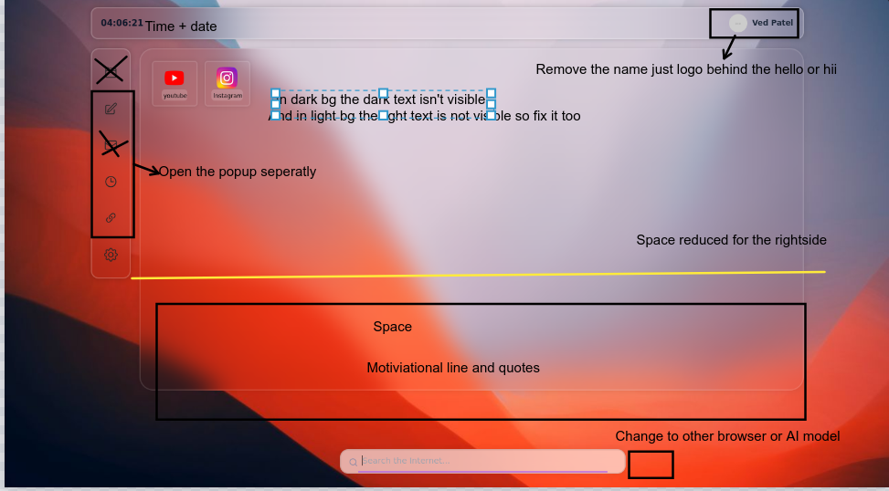

In This project that work i build an extension in chromium based browser. Where a user can use it for the productivity.

### Its purpose 
- Saved links and URL of a websites  
- Write quick notes, mail,  
- set up Mail that used google
- Quickly search to any Search engine or Browser

### Features
- Changed looks good and modern
- URL shortner
- Seperated bookmark and particular site link
- Dynamic wallpaper updater
- Daily quotes or motivational lines

### Searchables
- Google
- DuckDuck go
- perplexity
    - Now if possible
        - Geminie
        - Chatgpt
        
